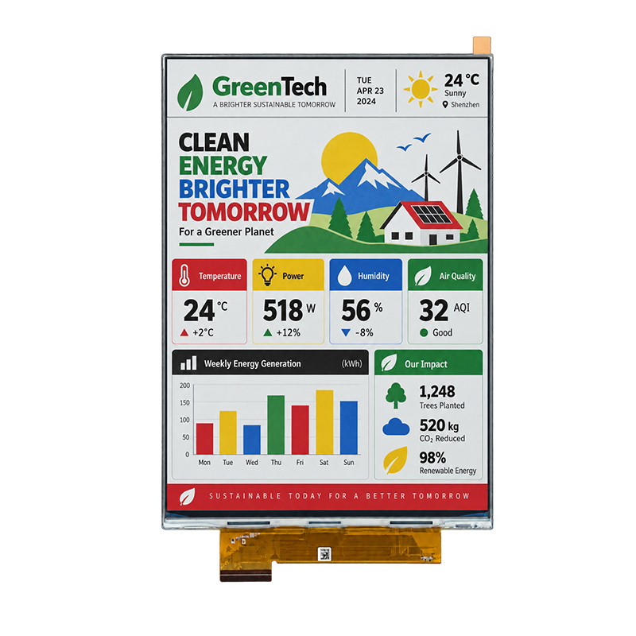

<p align="left"></p>

<h1 align="center">OSPTEK 13.3″ EPD Display 1200×1600 (EPD1330A01A3)</h1>

<p align="center"><b>EPD module · SPI/QSPI · PV61522x2+EK73601BAx1</b></p>

<p align="center"><a href="./README.md">简体中文</a> | English · <a href="../../README_EN.md">Family index</a></p>

<p align="center">
  
  
</p>

<p align="center"></p>

## Contents

- [Specifications](#specifications)
- [Resources](#resources)
- [Repository layout](#repository-layout)
- [Buy](#buy)
- [Support](#support)

---

## Specifications

| Item | Spec |
| ---- | ---- |
| Size | 13.3 inch |
| Type | EPD |
| Resolution | 1200×1600 |
| Outline | 208.8 x 284.7 x 0.85 mm |
| Active area | 202.8 x 270.4 mm |
| Interface | SPI/QSPI |
| Driver IC | PV61522x2+EK73601BAx1 |
| Touch IC | — |

> Full outline, FPC definition, power, and timing follow the product datasheet / driver IC datasheet.

## Resources

| Category | File |
| ---- | ---- |
| Datasheet | [`EPD1330A01A3.pdf`](./datasheets/EPD1330A01A3.pdf) |

## Repository layout

```text
display-epd-13.3inch-1200x1600/ # repo root (nav: ../../README_EN.md; sample projects under root examples/)
└── versions/
    └── EPD1330A01A3/        # full materials for this part number
        ├── README.md
        ├── README_EN.md
        ├── osptek.yml
        ├── images/
        └── datasheets/       # product datasheet + driver/touch IC datasheets
```

## Buy

See the [repo home page](../../README_EN.md#where-to-buy).

## Support

See the [repo home page](../../README_EN.md#support).

---

<p align="center"><sub>© 2026 OSPTEK · Materials in this repository are licensed under CC BY 4.0</sub></p>
